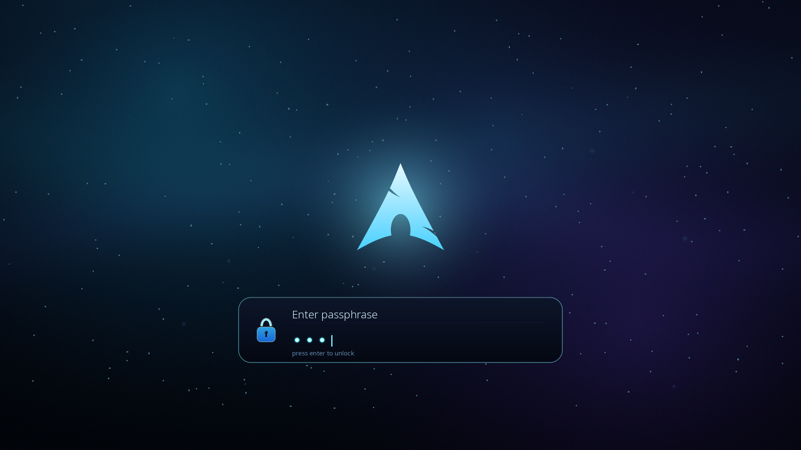
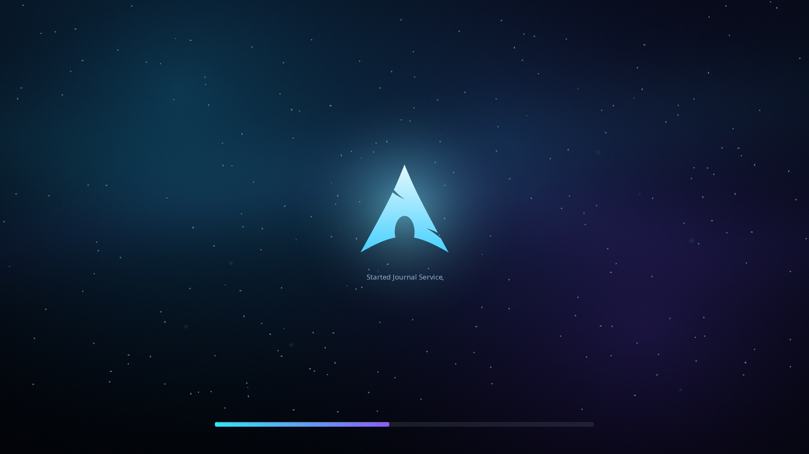

# arch-sky

A Plymouth `script` theme for the Arch box: aurora/starfield background, a
tinted Arch logo with a slow halo and orbiting sparks, a frosted passphrase
panel, and a thin progress line that stays out of the way.

Passphrase entry:



Normal boot (logo, live status, thin progress line):



## What changed from the stock `script` theme

- **Passphrase entry** is now a glass panel: padlock, the real LUKS prompt,
  animated passphrase dots, a blinking caret, and a short shake + red flush
  when the passphrase is wrong. On success the panel fades out and a green
  pulse runs through the logo.
- **The progress bar** is no longer the chunky boxed bar. It is a 6–8 px
  cyan→violet line at the bottom edge. It fades out during passphrase entry
  and in shutdown/reboot modes, because a boot progress bar there is
  meaningless.
- **Live status**: the last systemd unit status is shown as a quiet subtitle
  under the logo (the same text `Esc`/the console would show).
- The layout scales from screen height, so it should look right on 1080p,
  1440p and 4K.

## Install

From your pacman repository:

```nushell
sudo pacman -Syu plymouth-theme-arch-sky
sudo plymouth-set-default-theme -R arch-sky
```

The package definition is in `packaging/plymouth-theme-arch-sky/`. Or install
from this checkout, which copies the files and rebuilds in one go:

```nushell
sudo /var/lib/opencode-agent/coding/bla/arch-sky/install.sh
```

This copies the theme to `/usr/share/plymouth/themes/arch-sky`, selects it,
and rebuilds the initramfs. The config is backed up to
`/etc/plymouth/plymouthd.conf.bak-arch-sky`.

To preview the geometry without rebooting, look at `preview.png` next to this
README.

## The ~5 seconds of splash art

That is almost certainly the **static UKI splash**, not the Plymouth theme.
`/etc/mkinitcpio.d/linux.preset` contains:

```ini
default_options="--splash /usr/share/systemd/bootctl/splash-arch.bmp"
```

`ukify` embeds that bitmap in the `.splash` section of
`/boot/EFI/Linux/arch-linux.efi`. `systemd-stub` displays it while it loads and
verifies the ~180 MB unified kernel image, then the kernel starts and Plymouth
takes over. There is **no timeout for that section** — it simply stays until
the stub hands off. On this machine the loader takes ~0.8 s, the kernel ~2.8 s,
and the initrd starts after that, which is your ~5 s of static Arch art.

So it cannot be "set to 2 seconds". The two real choices are:

1. **Remove it** (recommended if the static art bothers you): the screen goes
   dark/black for those few seconds and then the animated Plymouth theme
   appears. The installer does this for you:

   ```nushell
   sudo /var/lib/opencode-agent/coding/bla/arch-sky/install.sh --no-uki-splash
   ```

   It backs up the preset to `/etc/mkinitcpio.d/linux.preset.bak-arch-sky`
   and strips `--splash` before rebuilding.

2. **Make the UKI smaller** so the static art is on screen for less time.
   The image is already zstd-compressed; the remaining wins are dropping
   unused firmware/modules from the initramfs. That is a separate tuning
   exercise and does not make the art disappear, only shortens the load.

If by "splash art" you meant the **Plymouth** screen (logo + background), its
lifetime is tied to boot completion, not a theme timeout. The new theme fades
the progress line and returns the logo as soon as the passphrase is accepted;
Plymouth itself disappears when `plymouth-quit` runs at the end of boot.

## Rollback

```nushell
sudo plymouth-set-default-theme -R script
```

And to restore the static UKI splash:

```nushell
sudo cp -a /etc/mkinitcpio.d/linux.preset.bak-arch-sky /etc/mkinitcpio.d/linux.preset
sudo mkinitcpio -P
```

## Tweaking

- Assets are generated by `tools/make_assets.py` (Pillow + numpy). Edit the
  colours/geometry there and rerun it; then reinstall.
- Colours, sizes and timings are top-level values in `arch-sky.script`
  (`logo_size`, `dlg_y`, the progress line at `H * 0.935`, etc.).
- The theme directory is self-contained, so `plymouth-set-default-theme -R
  arch-sky` is enough after an edit.
